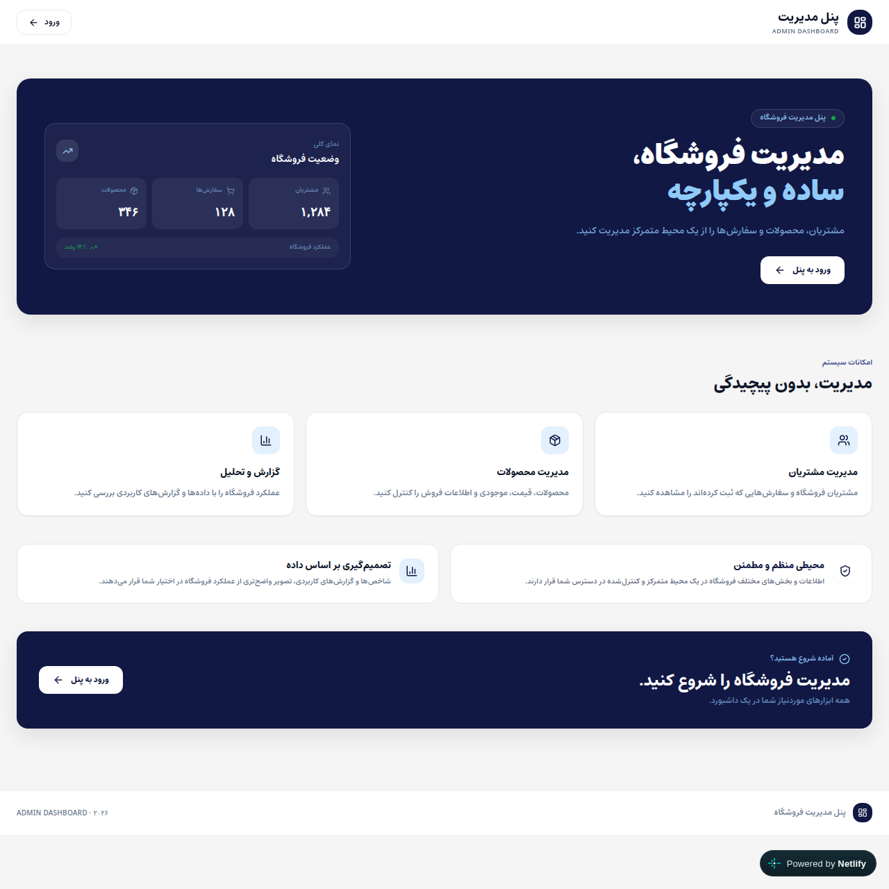

# Shopino Admin Dashboard

An e-commerce admin dashboard with orders, products, customers, analytics and team management, built around a **single shared permission system with five roles**. Persian-first (RTL) interface.

**[Live demo](https://admindashboardstate.netlify.app/)**



> **This is a front-end project with a simulated backend.** There is no server or database: a mock API layer keeps data in `localStorage`, login only checks that the email belongs to a demo account, and the password is **not** verified. Role-based access is enforced in the UI to demonstrate the architecture; a real system must enforce the same rules on the server.

**Built with:** React · TypeScript · Vite · React Router · Zustand · TanStack Table · Recharts · Tailwind CSS · Vitest

## Try it

Log in with any of these emails and **any non-empty password**:

| Email | Role | What the role can do |
| --- | --- | --- |
| `admin@shopino.ir` | System admin | Everything, including team management and resetting data |
| `ali.rezaei@shopino.ir` | Admin | Products, orders, analytics |
| `negar.karimi@shopino.ir` | Sales manager | Products, orders, analytics |
| `reza.kazemi@shopino.ir` | Salesperson | Products and orders, no analytics |
| `sara.mohammadi@shopino.ir` | Analyst | Read-only everywhere, including analytics |

Log in as different roles to see pages disappear from the sidebar, routes redirect to a "forbidden" page, and action buttons become disabled.

## What it does

- **Dashboard and analytics:** revenue chart, order status breakdown, top products, low-stock alerts, recent orders and activity
- **Orders and products:** searchable, filterable, sortable tables with create, edit and delete, plus detail pages
- **Customers:** a read-only view derived from order history
- **Team and settings:** manage staff (system admin only), reset or clear demo data (system admin only)
- **Extras:** CSV export that opens correctly in Excel with Persian text, notifications panel, mobile sidebar, breadcrumbs, per-page document titles

## Key engineering decisions

**One source of truth for permissions.** `utils/permissions.ts` defines which role can open which page and perform which sensitive action. Route guards, sidebar items and action buttons all read from it, so a rule is written once and cannot drift between the router and the UI.

**Route protection in two layers.** `RequireAuth` redirects guests to login and remembers where they were going; `RequireRole` redirects signed-in users without the right role to a forbidden page.

**Defensive storage.** Data read from `localStorage` is validated and sanitized before use; corrupted or hand-edited data falls back to the sample dataset instead of crashing the app.

**A fetching hook with race protection.** `useData` ignores responses from outdated requests, retries failed calls, and stops retrying after unmount.

**Safe CSV export.** Cells are quoted correctly, and text that starts with `=`, `+`, `-` or `@` is neutralized so a spreadsheet cannot execute it as a formula.

## Testing

Unit tests with Vitest cover the two pieces of logic where mistakes are easiest to make and hardest to notice:

- **Permissions:** the full access matrix for all five roles (page access and sensitive actions)
- **CSV export:** quoting rules and neutralization of spreadsheet formulas

```bash
npx vitest run
```

## Known limitations

- No real backend: authentication is simulated and permissions are enforced client-side only
- Data lives in the browser, so each visitor sees their own copy
- Stock is not decremented when an order is created
- No component or end-to-end tests yet
- Next: a real API with server-side authorization, UI tests, and a CI pipeline

## Getting started

Requirements: Node.js 20+.

```bash
git clone https://github.com/mina-gharzi/admin-dashboard.git
cd admin-dashboard
npm install
npm run dev
```

## Project structure

```
src/pages/       route-level screens
src/components/  UI grouped by feature (order, product, customer, analytics, layout, ui)
src/routes/      route definitions and guards (RequireAuth, RequireRole)
src/utils/       permissions, formatting, CSV export
src/services/    mock API and storage helpers
src/store/       Zustand stores (auth, UI)
src/hooks/       data fetching and UI hooks
```

## License

This is a personal portfolio project and is not licensed for commercial reuse.